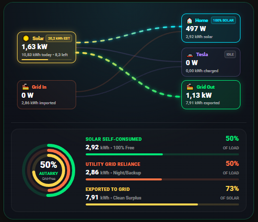

# ⚡ Home Assistant Real-Time Energy Flow & Autarky Scorecard Card

An ultra-responsive, hardware-accelerated **Real-Time Energy Flow & Executive Autarky Scorecard Card** for **Home Assistant**. Unifies real-time physical power distribution curves, an executive 3-ring autarky scorecard, Solcast PV solar forecast pacing, and an intelligent utility contracted power guard into a single high-performance Lovelace card.


---

## 📸 Visual Overview

<p align="center">
  
</p>

---

## 🌟 Key Features

1. **Executive 3-Ring Autarky Scorecard**:
   - Concentric bold SVG activity rings displaying live energy autonomy metrics:
     - 🟢 **Outer Ring (Autarky %)**: Percentage of today's total household energy sourced from self-produced solar.
     - 🟡 **Middle Ring (Self-Consumed %)**: Percentage of today's solar generation directly consumed on-site.
     - 🟠 **Inner Ring (Grid Export % / Dependency)**: Direct visual ratio of energy sent to or drawn from the grid.
   - High-contrast typography and clear percentage readouts designed for at-a-glance visibility across mobile companion apps and wall-mounted dashboard tablets.

2. **Hiccup-Free Velocity Scaling (`playbackRate` Web Animations API)**:
   - Uses native browser compositor time dilation via the Web Animations API (`path.getAnimations()[0].playbackRate`) instead of re-evaluating CSS `animationDuration`.
   - Completely eliminates keyframe phase resets, micro-stutters, and timeline skips when sensor wattage jitters.

3. **Smart Contracted Utility Power Guard (ICP)**:
   - Real-time utility contract overload protection based on your contracted power limit (`contract_power_limit_kw`).
   - **Amber Warning Glow**: Activates at $85\%$ of contracted capacity to notify you before heavy appliance draw trips the circuit breaker.
   - **Flashing Crimson Overload Alarm**: Triggers at $\ge 100\%$ capacity with animated alarm glow when household draw exceeds the utility ceiling.
   - **Smart Solar Balancing**: Solar power generated during daylight adds *on top* of the contracted grid ceiling, allowing total household power to exceed the contract without tripping the breaker. At night, the Home node border synchronizes to warm coral to visually indicate 100% grid reliance.

4. **Symmetrical 118px Executive Node Architecture**:
   - Perfectly balanced 118px source and consumer nodes:
     - **☀️ Solar Box**: Live generation (Watts), today's yield (kWh), and dynamic forecast pacing.
     - **⚡ Grid Box**: Net power flow, daily import/export accumulator, and live ICP threshold alerts.
     - **🚗 EV / Consumer Box**: High-draw load monitoring with dynamic active/idle status.
     - **🏠 Home Box**: Net household power, solar fraction percentage badge, and dynamic state styling.

5. **Optional Solcast PV Forecast Integration**:
   - Frosted gold forecast badge (`XX.X kWh EST`) and micro progress bar tracking today's actual yield against the estimated target.
   - **100% Optional**: If you don't use Solcast, simply disable it (`show_solar_forecast: false`) or omit the sensors; the card cleanly hides the badge and centers the solar metrics.

---

## 💡 How to Adapt for Your Installation

### 1. Setting the Contracted Power Guard (ICP)
Different countries and utility contracts specify maximum simultaneous draw (for example, $3.3\text{ kW}$, $4.2\text{ kW}$, $5.5\text{ kW}$, or $6.9\text{ kW}$ in Spain / Europe).

Configure `contract_power_limit_kw` to your utility contract limit:
```yaml
contract_power_limit_kw: 4.2  # Set to your contracted kW limit
contract_warning_pct: 0.85    # Warning amber glow threshold (default: 85%)
```
- When net grid import is below $85\%$, the card renders a clean normal border.
- Between $85\%$ and $99\%$, the Grid node glows amber with a `${pct}% ICP` badge.
- At $\ge 100\%$, the Grid node flashes crimson with an `OVERLOAD ${pct}%` warning.

### 2. Using with or without Solar Forecast (Solcast)
- **With Solcast / Forecast Sensors**:
  Provide your forecast sensors under `entities.solcast_today` and `entities.solcast_remaining`. The card automatically renders the frosted gold badge and live progress bar.
- **Without Solcast (Core Energy Flow Only)**:
  Set `show_solar_forecast: false` in your YAML config. The card completely hides the forecast pill and progress bar, cleanly expanding and centering today's solar yield.

### 3. Customizing the EV / Consumer Node
By default, the EV node is labelled "Tesla". You can customize this label for any electric vehicle or heavy appliance (e.g., "Wallbox", "EV", "Heat Pump", "HVAC"):
```yaml
ev_name: "Wallbox"
```

### 4. Customizing System Power Envelope
The flow animation dynamically adjusts speed from leisurely idle down to high-velocity stream using logarithmic scaling. Set `max_expected_power_kw` to match your peak array size or inverter ceiling (e.g. $5.0$, $7.5$, $10.0$ kW):
```yaml
max_expected_power_kw: 7.5  # Inverter peak capacity
```

---

## 🚀 Quick Start Installation

### Method 1: Manual Installation (Recommended)

1. Download [`ares-energy-flow-card.js`](./ares-energy-flow-card.js) from this repository.
2. Copy `ares-energy-flow-card.js` into your Home Assistant `<config>/www/` directory (e.g. via Samba, SSH, or Studio Code Server).
3. In Home Assistant, navigate to **Settings** $\rightarrow$ **Dashboards** $\rightarrow$ **Three Dots (⋮)** in the top right $\rightarrow$ **Resources**.
4. Click **Add Resource**:
   - **URL**: `/local/ares-energy-flow-card.js`
   - **Resource Type**: `JavaScript Module`
5. Refresh your browser or companion app.

### Method 2: HACS Custom Repository

1. Open **HACS** in Home Assistant.
2. Click the **Three Dots (⋮)** in the top right $\rightarrow$ **Custom repositories**.
3. Paste repository URL: `https://github.com/Aresitoo/ha-energy-flow-card`
4. Category: **Dashboard** (or **Plugin / Lovelace**).
5. Click **Add**, find **Ares Energy Flow & Autarky Scorecard**, and click **Download**.

---

## 🛠️ Complete Configuration Options

Add the card to any Lovelace view:

```yaml
type: custom:ares-energy-flow-card
contract_power_limit_kw: 4.2
contract_warning_pct: 0.85
max_expected_power_kw: 7.5
show_solar_forecast: true
ev_name: "Tesla"
entities:
  # Solar:
  solar_power: sensor.solar_power
  solar_daily_yield: sensor.solar_daily_yield

  # Grid:
  grid_power: sensor.grid_power
  grid_daily_import: sensor.grid_daily_import_energy
  grid_daily_export: sensor.grid_daily_export_energy

  # EV / Heavy Load:
  ev_power: sensor.ev_charging_power
  ev_charging: binary_sensor.ev_charging
  ev_daily_energy: sensor.ev_daily_energy

  # Forecast (Optional):
  solcast_today: sensor.solcast_pv_forecast_forecast_today
  solcast_remaining: sensor.solcast_pv_forecast_forecast_remaining_today
```

### Configuration Reference

| Option | Type | Default | Description |
|---|---|---|---|
| `type` | string | **Required** | Must be `custom:ares-energy-flow-card` |
| `contract_power_limit_kw` | number | `4.2` | Contracted utility power limit in kW (ICP limit) |
| `contract_warning_pct` | number | `0.85` | Ratio of contracted limit at which amber warning activates ($0.85 = 85\%$) |
| `max_expected_power_kw` | number | `7.5` | System peak power envelope for velocity scaling ($7.5 = 7500\text{ W}$) |
| `show_solar_forecast` | boolean | `true` | Display Solcast estimate badge and progress bar |
| `ev_name` | string | `"Tesla"` | Custom title for the top-right consumer node |
| `entities.solar_power` | string | `sensor.solar_power` | Real-time solar production in Watts |
| `entities.solar_daily_yield` | string | `sensor.solar_daily_yield` | Cumulative solar yield today in kWh |
| `entities.grid_power` | string | `sensor.grid_power` | Net grid power in Watts (positive = import, negative = export) |
| `entities.grid_daily_import` | string | `sensor.grid_daily_import_energy` | Cumulative grid energy imported today in kWh |
| `entities.grid_daily_export` | string | `sensor.grid_daily_export_energy` | Cumulative grid energy exported today in kWh |
| `entities.ev_power` | string | `sensor.ev_charging_power` | Real-time EV charger or appliance draw in Watts |
| `entities.ev_charging` | string | `binary_sensor.ev_charging` | Binary sensor indicating active charging state |
| `entities.ev_daily_energy` | string | `sensor.ev_daily_energy` | Cumulative EV charger energy today in kWh |
| `entities.solcast_today` | string | `sensor.solcast_pv_forecast_forecast_today` | Solcast today's estimated forecast in kWh |
| `entities.solcast_remaining` | string | `sensor.solcast_pv_forecast_forecast_remaining_today` | Solcast remaining forecast today in kWh |

---

## 📄 License

This project is licensed under the [MIT License](LICENSE).
